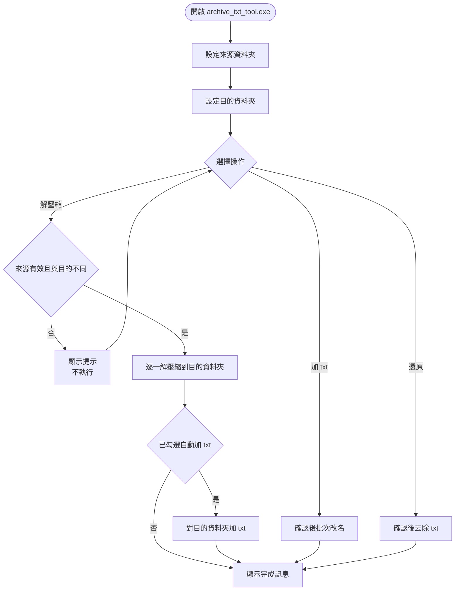
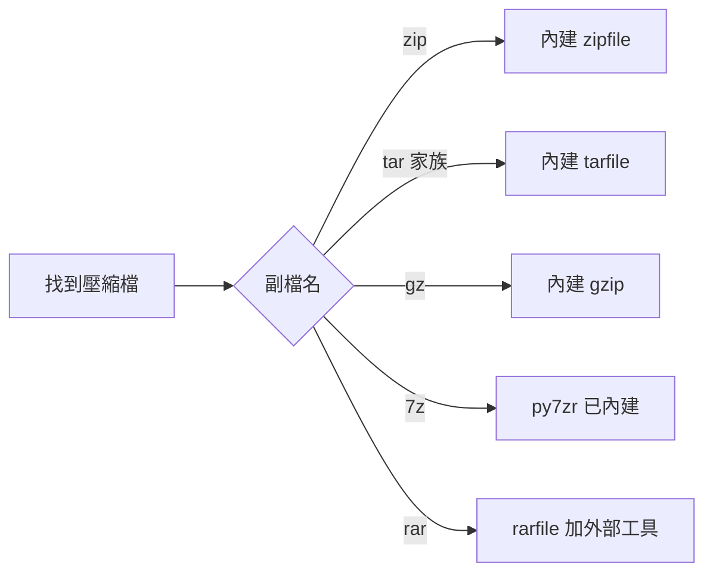

# 壓縮檔解壓縮 / 副檔名 .txt 轉換工具 使用手冊

這是一套 Windows 桌面小工具：把一整個資料夾裡的壓縮檔批次解壓縮到指定位置，再批次替檔案加上或移除 `.txt` 副檔名。使用打包好的 `dist\archive_txt_tool.exe` 時**不需要安裝 Python**，單一檔案即可執行；作業系統需為 64 位元的 Windows 10 或 Windows 11。

> 常見用途：某些系統只接受 `.txt` 上傳，先把整批網頁、程式碼或文件改成 `檔名.html.txt`，處理完再還原。

---

## 目錄

- [快速取得](#快速取得)
- [快速開始](#快速開始)
- [整體使用流程](#整體使用流程)
- [操作介面](#操作介面)
- [功能一 批次解壓縮](#功能一-批次解壓縮)
- [功能二 加上 txt 副檔名](#功能二-加上-txt-副檔名)
- [功能三 還原檔案名稱](#功能三-還原檔案名稱)
- [輸出結果與檔案格式](#輸出結果與檔案格式)
- [使用前注意與資料安全](#使用前注意與資料安全)
- [常見問題與排錯](#常見問題與排錯)
- [從原始碼建置](#從原始碼建置)

---

## 快速取得

| 項目 | 內容 |
|---|---|
| 執行檔 | `dist\archive_txt_tool.exe`（約 17 MB） |
| 安裝需求 | 無，免安裝、不寫登錄檔 |
| 系統需求 | 64 位元 Windows 10 / 11 |
| 網路 | 不需要連線 |

把 `archive_txt_tool.exe` 複製到任何資料夾或 USB 隨身碟都能執行，不一定要留在專案目錄。

**首次執行可能出現藍色視窗「Windows 已保護您的電腦」**，原因是執行檔沒有數位簽章：

1. 點「更多資訊」。
2. 點「仍要執行」。

這是 Windows SmartScreen 的常規提示，不是病毒警告。

---

## 快速開始

1. 雙擊 `archive_txt_tool.exe`，視窗標題為「壓縮檔解壓縮 / 副檔名 .txt 轉換工具」。
2. 在「來源資料夾」按「瀏覽...」，選擇放壓縮檔的資料夾。
3. 在「目的資料夾」按「瀏覽...」，選擇解壓縮結果要放的位置。若資料夾還沒建立，第一次執行動作時會詢問是否建立，選「是」即可。
4. 需要連同子資料夾裡的壓縮檔一起處理時，保持勾選「包含來源子資料夾內的壓縮檔」（預設已勾選）。
5. 按「① 解壓縮」，等待進度條跑完並出現「解壓縮完成：成功 N，失敗 M」訊息。
6. 到目的資料夾確認結果，每個壓縮檔會各自建立一個同名資料夾。
7. 需要加 `.txt` 時按「② 副檔名加 .txt」；要改回來按「③ 還原(去除 .txt)」，兩者都會先跳出確認視窗。

---

## 整體使用流程



三個操作彼此獨立，順序可自由安排；最常見的組合是「① 解壓縮 → ② 加 .txt → 用完 → ③ 還原」。

---

## 操作介面

### 資料夾設定

畫面上方兩列分別是「來源資料夾」與「目的資料夾」，右側「瀏覽...」按鈕會開啟資料夾選擇視窗。

| 欄位 | 用途 | 檢查規則 |
|---|---|---|
| 來源資料夾 | 要掃描壓縮檔的位置 | 解壓縮時必須存在且是資料夾 |
| 目的資料夾 | 輸出與改名的作用範圍 | 空白會提示；不存在會詢問是否建立 |

- 解壓縮時，來源與目的**不可相同**，否則會顯示「來源與目的資料夾不可相同」並中止。
- 加 `.txt` 與還原只使用「目的資料夾」，不需要填來源。

### 選項

| 選項 | 預設 | 說明 |
|---|---|---|
| 包含來源子資料夾內的壓縮檔 | 勾選 | 取消勾選時只掃描來源資料夾第一層 |
| 解壓縮後自動加上 .txt | 未勾選 | 解壓縮完成後，立刻對**整個目的資料夾（含子目錄）**加 `.txt` |

> 「自動加上 .txt」的範圍不只這次解出來的新檔案，目的資料夾裡原本就存在的檔案也會一併處理。

### 操作按鈕

| 按鈕 | 動作 | 事前確認 |
|---|---|---|
| ① 解壓縮 | 掃描並解壓所有找到的壓縮檔 | 目的資料夾不存在時詢問建立 |
| ② 副檔名加 .txt | 目的資料夾內所有檔案，在檔名後加上 `.txt` | 有確認視窗 |
| ③ 還原(去除 .txt) | 目的資料夾內所有 `.txt` 檔移除結尾的 `.txt` | 有確認視窗 |

執行期間三個按鈕會變灰色無法點擊，需等完成訊息出現。中途失敗不會中斷整批，單一項目失敗會記錄在「執行記錄」後繼續處理下一個。

### 進度與狀態

- 進度條：顯示目前處理到第幾個項目。
- 狀態列：顯示「進度 i/n」，完成後顯示結果摘要。
- 批次處理結束時會跳出完成對話框，即使其中幾項失敗也會顯示成功／失敗統計；若發生未預期的例外，則不跳對話框，只在「執行記錄」留下 `[錯誤]` 訊息，狀態列顯示錯誤內容。

### 執行記錄

視窗下方的文字框會逐筆列出：

- `共找到 N 個壓縮檔`
- `[成功] 壓縮檔路徑 -> 輸出資料夾 (N 個檔案)`
- `[失敗] 壓縮檔路徑: 原因`
- 完成統計

記錄只存在畫面上，**不會寫入檔案**，關閉程式後即消失。可以選取文字後按 `Ctrl+C` 複製需要的內容。

---

## 功能一 批次解壓縮

掃描來源資料夾（可含子資料夾），依照副檔名選擇對應的處理方式，每個壓縮檔解到「目的資料夾\壓縮檔名稱\」。



### 支援格式

| 副檔名 | 處理方式 | 說明 |
|---|---|---|
| `.zip` | Python 內建 `zipfile` | 會自動修正未標示 UTF-8 的中文檔名 |
| `.tar` `.tar.gz` `.tgz` `.tar.bz2` `.tbz2` `.tar.xz` `.txz` | Python 內建 `tarfile` | 只解一般檔案與資料夾，略過符號連結與裝置檔 |
| `.gz` | Python 內建 `gzip` | 單一檔案壓縮，會解出一個去掉 `.gz` 的檔案 |
| `.7z` | `py7zr`（已打包進 exe） | 加密的 7z 沒有密碼輸入介面，會解壓失敗 |
| `.rar` | `rarfile`（已打包）＋外部程式 | 需電腦上有 `unrar`、`7z` 或 `bsdtar` 其中之一 |

副檔名比對不分大小寫，`.ZIP`、`.Zip` 都能處理。判斷順序為長到短，所以 `.tar.gz` 不會被誤認為 `.gz`。

### 輸出資料夾命名

- `report.zip` → `目的資料夾\report\`
- `data.tar.gz` → `目的資料夾\data\`
- `single.txt.gz` → `目的資料夾\single.txt\`，裡面是 `single.txt`

若同名資料夾已存在，會自動加上序號：`report`、`report_1`、`report_2`，不會覆蓋既有內容。

### 壓縮檔內部結構

壓縮檔內的目錄結構會原樣保留，例如 zip 裡有 `css/style.css`，解出來就是 `目的資料夾\report\css\style.css`。

### 安全機制

- 解壓路徑會被檢查，若壓縮檔內含 `../` 之類想跳出目的資料夾的路徑，**整個壓縮檔**會標示為失敗並記錄，不會寫到資料夾外。
- `.tar` 內的符號連結、硬連結、裝置檔一律略過，只解一般檔案。

---

## 功能二 加上 txt 副檔名

對「目的資料夾」內所有檔案（含子目錄）改名：

```text
a.html      -> a.html.txt
style.css   -> style.css.txt
readme.txt  -> readme.txt（略過，已是 .txt 結尾）
```

- 已是 `.txt` 結尾的檔案會略過，避免重複執行變成 `a.txt.txt`。
- 使用重新命名而非複製，速度快、不佔額外空間。
- 若目標檔名已存在（例如 `a.html.txt` 已有人佔用），該檔案會記錄為失敗並跳過，不會覆蓋。
- 按下按鈕後會先顯示確認視窗，列出將處理的目的資料夾完整路徑。

完成訊息格式：`加 .txt 完成：成功 X，略過 Y，失敗 Z`。

---

## 功能三 還原檔案名稱

對「目的資料夾」內所有 `.txt` 結尾的檔案（含子目錄）移除結尾的 `.txt`：

```text
a.html.txt  -> a.html
style.css.txt -> style.css
```

- 若移除後的檔名已存在，該檔案記錄為失敗並跳過。
- 按下按鈕後同樣會先顯示確認視窗。

完成訊息格式：`還原完成：成功 X，略過 Y，失敗 Z`。

> ⚠️ **還原無法分辨「原本就是 .txt」的檔案。** 例如資料夾內原本有一個 `note.txt`，按「還原」後會變成 `note`。若目的資料夾混有原生 `.txt` 檔，請先自行備份或移出。

---

## 輸出結果與檔案格式

### 解壓縮

| 來源 | 輸出位置 | 範例內容 |
|---|---|---|
| `report.zip` | `目的\report\` | 保留 zip 內目錄結構 |
| `data.tar.gz` | `目的\data\` | 保留 tar 內目錄結構 |
| `photos.7z` | `目的\photos\` | 保留 7z 內目錄結構 |
| `single.txt.gz` | `目的\single.txt\` | `single.txt` |
| 同名的第二個 `report.zip` | `目的\report_1\` | 不覆蓋前一次結果 |

### 改名

| 處理前 | 按「② 加 .txt」後 | 按「③ 還原」後 |
|---|---|---|
| `index.html` | `index.html.txt` | `index.html` |
| `app.js` | `app.js.txt` | `app.js` |
| `note.txt` | `note.txt`（略過） | `note`（⚠️ 原 `.txt` 也會被去掉） |

### 失敗時

失敗的項目不會中斷整批，會出現在「執行記錄」中，格式為：

```text
[失敗] D:\Work\out\a.html: 目標檔名已存在
```

最後的完成訊息只統計成功／略過／失敗數量，詳細原因要看執行記錄。

---

## 使用前注意與資料安全

- **改名會直接動到原檔**，不做複製、不建立備份。第一次使用建議先拿一個測試資料夾試跑。
- 「還原」不是「加 .txt」的完全反操作，原生 `.txt` 檔也會被去掉副檔名（見上一節）。
- 程式**不連網**、不上傳任何檔案，也沒有安裝程序或背景服務。
- 解壓縮只會寫入目的資料夾；來源壓縮檔本身不會被修改或刪除。
- 執行期間請不要關閉視窗，否則可能留下解壓到一半的檔案，需自行清理該次的目的資料夾。
- 有密碼保護的壓縮檔沒有密碼輸入介面，會解壓失敗。
- `.rar` 需要電腦上有 `unrar`、`7z` 或 `bsdtar`；其他格式（zip、7z、tar、gz）由 exe 內建處理，不需額外程式。

---

## 常見問題與排錯

### 雙擊後出現「Windows 已保護您的電腦」

執行檔沒有數位簽章，Windows SmartScreen 對不熟悉的檔案都會提示。

點「更多資訊」→「仍要執行」。若公司電腦受政策管制而沒有「仍要執行」按鈕，需請 IT 人員放行。

### 雙擊後沒有畫面

單檔 exe 啟動時會先解壓到暫存資料夾，通常 1～3 秒才會出現視窗。

若超過 10 秒仍無反應，可能是防毒軟體隔離了檔案，請檢查防毒隔離區，或把 exe 加入信任清單。

### 顯示「找不到壓縮檔」

- 確認來源資料夾內確實有支援格式的檔案。
- 若壓縮檔放在子資料夾，請勾選「包含來源子資料夾內的壓縮檔」。
- 只支援 `.zip`、`.tar`、`.tar.gz`、`.tgz`、`.tar.bz2`、`.tbz2`、`.tar.xz`、`.txz`、`.gz`、`.7z`、`.rar`，其他副檔名會被忽略。

### 顯示「未安裝 py7zr，無法解壓縮 .7z」

只有用原始碼 `python archive_txt_tool.py` 執行時才可能出現，代表環境缺少套件。

改用 `dist\archive_txt_tool.exe`，或執行 `python -m pip install -r requirements.txt`。

### 顯示「未安裝 rarfile，無法解壓縮 .rar」

同上，原始碼執行時未安裝套件。另外 exe 雖已內建 `rarfile`，仍需要系統中有 `unrar`、`7z` 或 `bsdtar` 才能實際解壓 RAR。

最簡單的做法：安裝 7-Zip，確認 `7z.exe` 在 PATH 中。

### 顯示「請指定目的資料夾」或「請指定有效的來源資料夾」

欄位是空白或路徑有誤。按「瀏覽...」重新選擇，不要手動貼上含引號的路徑。

### 顯示「來源與目的資料夾不可相同」

解壓縮不能把結果放回來源資料夾，請改用另一個資料夾。

### 完成訊息顯示有「失敗」，但不知道原因

看視窗下方「執行記錄」，失敗項目會列出完整路徑與原因，常見原因：

| 記錄訊息 | 原因 | 解法 |
|---|---|---|
| `目標檔名已存在` | 要改成的檔名已被佔用 | 先處理或移開舊檔，再重跑 |
| `不安全的路徑` | 壓縮檔內含跳出目的資料夾的路徑 | 整個壓縮檔會跳過，屬保護機制 |
| `密碼` 相關錯誤 | 壓縮檔有密碼 | 先用 7-Zip 等工具解壓，再對資料夾加 `.txt` |

### 中文檔名變成亂碼

`.zip` 若是舊版工具製作、沒有標示 UTF-8，程式會依序嘗試 UTF-8、CP950、GBK、CP932 解碼。仍無法正確還原時，建議先用 7-Zip 手動解壓，再使用「② 副檔名加 .txt」處理該資料夾。

### 按鈕都是灰色不能按

目前正在執行中，等完成訊息出現後按鈕會恢復。若長時間沒反應且檔案很多，可先看「執行記錄」是否有新增內容。

### 檔案被其他程式鎖住而改名失敗

關閉正在開啟這些檔案的編輯器、預覽程式或同步軟體（例如 OneDrive），再重新執行。

### 設定會不會被記住

不會。程式不儲存任何設定，每次開啟都是空白欄位，兩個勾選項也回到預設值。

---

## 從原始碼建置

> 一般使用者不需要本節，直接使用 `dist\archive_txt_tool.exe` 即可。

### 環境需求

- Python 3.10 以上（本專案以 Python 3.13.9 建置並驗證）
- 相依套件見 `requirements.txt`

### 一鍵建置

雙擊 `build.bat`，它會依序執行安裝套件與打包：

```bat
python -m pip install -r requirements.txt
python -m PyInstaller --noconfirm --clean --onefile --windowed --name archive_txt_tool archive_txt_tool.py
```

完成後執行檔位於 `dist\archive_txt_tool.exe`。

### 手動建置

```powershell
python -m pip install -r requirements.txt
python -m PyInstaller --noconfirm --clean --onefile --windowed --name archive_txt_tool archive_txt_tool.py
```

打包設定另存於 `archive_txt_tool.spec`，之後也可直接用：

```powershell
python -m PyInstaller --noconfirm archive_txt_tool.spec
```

### 建置後驗證

1. 雙擊 `dist\archive_txt_tool.exe`，確認視窗正常開啟。
2. 準備一個含 `.zip` 與 `.7z` 的測試資料夾，跑一次解壓縮。
3. 按「②」加 `.txt`、再按「③」還原，確認檔名正確。

### 專案檔案

```text
archive_txt_tool.py     主程式（tkinter GUI 與解壓／改名邏輯）
archive_txt_tool.spec   PyInstaller 打包設定
build.bat               一鍵建置腳本
requirements.txt        相依套件清單
dist\                   打包產物（已被 .gitignore 忽略）
```
